# CROWN
## Canton Repo & Collateral Orchestration Network

> **Project type:** Institutional secured-funding DApp reference architecture  
> **Ledger/application model:** Daml contracts on Canton  


CROWN is a proposed privacy-aware workflow platform for secured funding. It models agreements, collateral, valuations, margin events, settlement instructions, maturity, and exceptions as coordinated multi-party workflows. It is designed to connect institutional participants without requiring every participant to receive every piece of information.

The first release should deliberately be narrow: implement a bilateral repo lifecycle with simulated cash/securities settlement adapters, strong Daml tests, and explicit state transitions. Add tri-party and clearing features only after the base lifecycle and operational controls are reliable.

---

## Contents

1. [Goals and non-goals](#1-goals-and-non-goals)
2. [Product scope](#2-product-scope)
3. [Reference architecture](#3-reference-architecture)
4. [Participants and trust boundaries](#4-participants-and-trust-boundaries)
5. [Contract architecture](#5-contract-architecture)
6. [Core domain model](#6-core-domain-model)
7. [Repo lifecycle](#7-repo-lifecycle)
8. [Collateral and margin workflows](#8-collateral-and-margin-workflows)
9. [Settlement architecture](#9-settlement-architecture)
10. [Privacy and authorization model](#10-privacy-and-authorization-model)
11. [Product extensions](#11-product-extensions)
12. [Backend and API design](#12-backend-and-api-design)
13. [Data and event flows](#13-data-and-event-flows)
14. [Failure handling and recovery](#14-failure-handling-and-recovery)
15. [Security architecture](#15-security-architecture)
16. [Testing strategy](#16-testing-strategy)
17. [Repository layout](#17-repository-layout)
18. [Local development and build workflow](#18-local-development-and-build-workflow)
19. [Deployment model](#19-deployment-model)
20. [Observability and operations](#20-observability-and-operations)
21. [Roadmap and acceptance criteria](#21-roadmap-and-acceptance-criteria)
22. [Risks and limitations](#22-risks-and-limitations)
23. [Glossary](#23-glossary)
24. [References](#24-references)

---

## 1. Goals and non-goals

### Goals

- Represent a repo agreement and its lifecycle as explicit, testable Daml contracts.
- Require the appropriate parties to authorize creation and changes to obligations.
- Keep bilateral trade data private to the parties that need it.
- Model collateral eligibility, valuation snapshots, haircuts, allocation, substitution, and release.
- Coordinate settlement using an adapter boundary rather than pretending an on-ledger instruction is proof of external payment.
- Make asynchronous workflows observable, retry-safe, and recoverable.
- Reuse the core model across related secured-funding products.
- Keep a clear separation between contractual facts, external evidence, derived analytics, and operational state.

### Non-goals for the first release

- Acting as a bank, broker-dealer, custodian, payment institution, central counterparty (CCP), or regulated trading venue.
- Claiming that a Daml contract itself transfers central-bank money, commercial-bank deposits, or securities held in an external CSD/custodian.
- Implementing a production default-management regime or legal netting opinion.
- Replacing an existing market's rulebook, GMRA, GMSLA, custody agreement, settlement system, or regulatory reporting obligations.
- Treating a demo price feed, simulated custodian, or mocked payment adapter as authoritative production evidence.
- Promising atomic delivery-versus-payment (DvP) across systems that do not support a compatible atomic transaction model.

---

## 2. Product scope

### 2.1 Initial product: bilateral government repo

A cash borrower receives cash and provides eligible government securities under an agreed repurchase transaction. At maturity, the borrower owes the repurchase amount and the securities are returned or released according to the legal agreement and settlement arrangement.

The app should model at least:

- Buyer/seller terminology consistently with the selected market convention.
- Cash principal, currency, repo rate, day-count convention, start date, maturity date, and repurchase amount.
- Collateral assets or basket rules, quantities, valuation currency, haircut, and concentration limits.
- Counterparty acceptance and cancellation before activation.
- Opening settlement status, lifecycle status, margin status, and maturity status.
- Evidence references from payment and custody systems.
- Exceptions such as settlement failure, stale valuation, margin dispute, and overdue maturity.

### 2.2 Related products

| Product | Reuse from core | Additional domain logic |
|---|---|---|
| Government repo | Agreement, collateral, valuation, settlement, maturity | Government-security eligibility and market conventions |
| Reverse repo | Same underlying transaction, viewed from cash-investor side | Role-specific views and reporting |
| Tri-party repo | Core repo and collateral modules | Agent mandate, basket allocation, substitutions, reconciliation |
| GCF-style repo | Repo and collateral basket concepts | Market-specific eligibility, netting, clearing and settlement conventions |
| Bilateral repo | Core product | Direct counterparty workflows and bilateral collateral control |
| Securities lending | Parties, collateral, valuation, lifecycle | Security loan, fee, manufactured payments and equivalent return |
| Securities borrowing | Same loan from borrower's perspective | Borrower obligations, return and collateral |
| Buy/sell-back | Parties, assets, settlement evidence | Paired sale and future repurchase legs; legal treatment differs by jurisdiction |
| Collateralized short-term loan | Collateral, valuation, repayment and release | Loan terms, pledge/perfection evidence, interest and repayment |
| CCP-connected repo | Trade submission, margin and lifecycle | Clearing membership, novation, CCP rules, default fund and default management |

**Design rule:** reverse repo is usually the cash investor's perspective of the same economic transaction, not an entirely separate ledger product. GCF-style repo and CCP clearing are not mere flags on a bilateral contract; they require market-specific legal and operational rules.

---

## 3. Reference architecture

### 3.1 System context

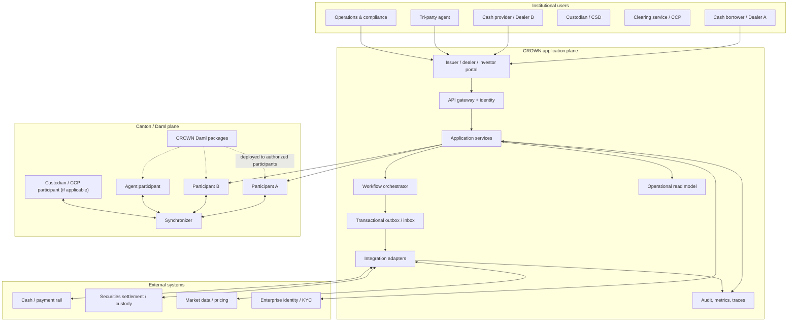

The application plane is responsible for user authentication, API composition, integration, read models, and operational orchestration. The Daml/Canton plane is the contractual coordination layer for workflows that require multi-party agreement and ledger-enforced authorization.

### 3.2 Logical layers

| Layer | Responsibility | Must not be treated as |
|---|---|---|
| Web UI | Trade entry, approval, collateral and operations screens | Authorization boundary by itself |
| API gateway / identity | Authentication, rate limits, request validation | Proof that a user is authorized to exercise a Daml choice |
| Application services | Business APIs, policy checks, command construction | Replacement for ledger authorization |
| Workflow orchestrator | Long-running external workflows and retries | Source of truth for contractual state |
| Daml contracts | Agreements, permissions, transitions and obligations | External asset registry or payment rail |
| Canton participants / synchronizer | Participant-specific ledger processing and coordination | One globally readable database |
| Adapters | Translate external requests, responses and events | Trustworthy merely because a message arrived |
| Read model | Search, dashboards, analytics | Authoritative contractual state |
| Audit/observability | Operational evidence and diagnostics | Substitute for legal records or mandated reporting |

### 3.3 Recommended interaction pattern

Use a **mediated backend** for the first release:

1. Frontend authenticates to CROWN.
2. Backend authorizes the user against institutional entitlements.
3. Backend queries a permitted read model or Ledger API.
4. Backend submits commands as the configured party identity.
5. Daml validates controllers, signatories, contract state, and constraints.
6. Backend returns a command result and correlates subsequent ledger events.
7. External integration occurs through adapters and tracked workflow records.

Do not let a browser hold broad participant credentials. Direct client-to-ledger interaction can be considered only with a carefully designed identity and authorization model.

---

## 4. Participants and trust boundaries

### 4.1 Roles

| Role | Main responsibilities | Typical visibility |
|---|---|---|
| Cash borrower | Propose/accept trade, provide collateral, repay cash | Its bilateral trade and relevant collateral |
| Cash provider | Accept trade, fund opening leg, receive repurchase amount | Its bilateral trade and relevant collateral |
| Tri-party agent | Allocate and manage collateral under mandate | Trades and assets covered by its mandate |
| Custodian / CSD | Confirm settlement, custody and asset movement | Instructions and holdings it services |
| Pricing provider | Supply prices, timestamps and source metadata | Only the pricing requests and instruments it serves |
| CCP / clearing service | Clearing acceptance, margin and default workflows | Trades and positions in its clearing scope |
| CROWN operator | Operate application services and integrations | Minimize business-data access; separate operational privileges |
| Auditor / compliance | Inspect permitted evidence and reports | Explicitly authorized records only |

### 4.2 Trust-boundary diagram

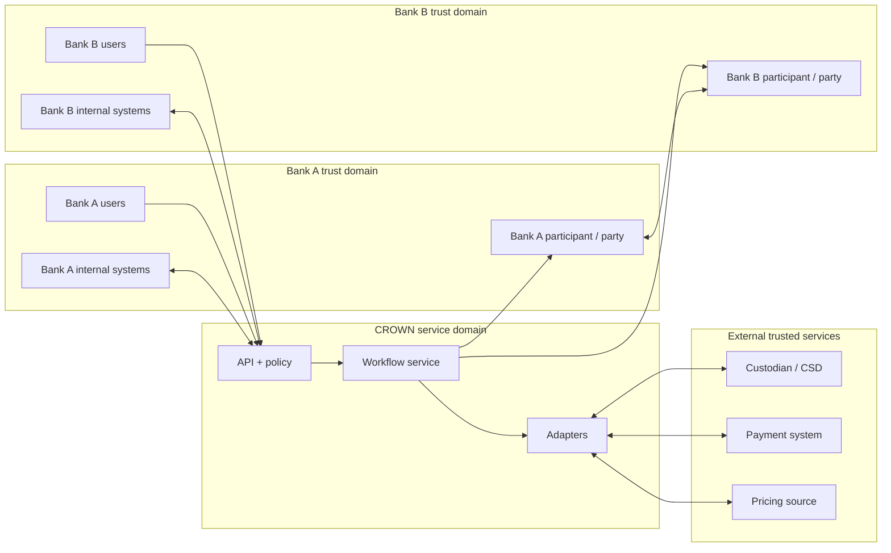

A production deployment should decide whether each institution runs its own backend and participant connection, whether a managed operator hosts some services, and who controls each signing identity. Hosting a party on a participant grants that participant access to the party's ledger data; hosting, submission and confirmation permissions therefore require careful governance.

---

## 5. Contract architecture

### 5.1 Design principles

1. **Model obligations, not UI screens.** Contracts represent agreements, entitlements, instructions, evidence and lifecycle transitions.
2. **Use immutable state transitions.** Daml contract state is changed by consuming/recreating a contract or by creating a related event/record; do not model mutable database rows inside a template.
3. **Use explicit consent.** A party should not be placed under a new obligation without its authorization.
4. **Keep controllers narrow.** Only the relevant role can exercise each choice.
5. **Minimize observers.** Every observer receives visibility into that contract. Add agents or auditors only where needed.
6. **Separate proposal from acceptance.** Use propose/accept patterns when multiple parties must agree.
7. **Separate contractual status from external status.** “Settlement requested” is not “settled.”
8. **Make external evidence attributable.** Record source system, reference, timestamp, status and evidence digest where appropriate.
9. **Avoid storing secrets.** Never put credentials, private keys, API tokens, or unnecessary personal data in ledger contracts.
10. **Version financial conventions.** Day count, calendars, rate conventions, eligibility rules and haircut rules must be explicit and governed.

### 5.2 Package and module map

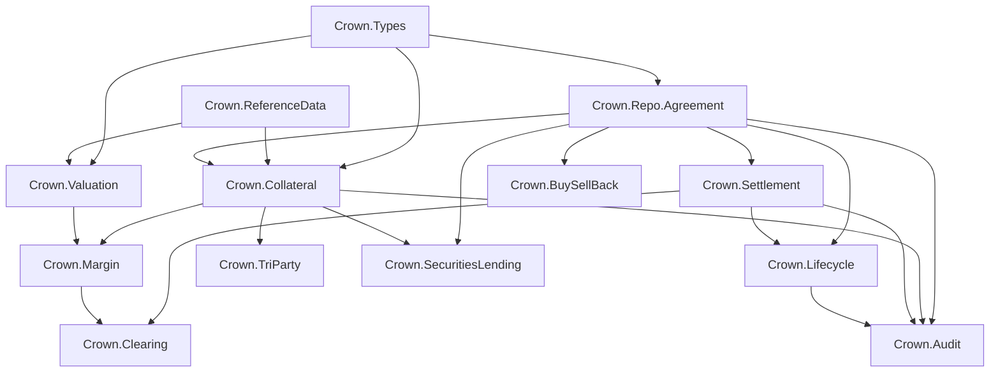

This is a logical dependency map, not a requirement that every module directly import every other module. Keep shared data types small and avoid circular module dependencies.

### 5.3 Proposed templates and responsibilities

| Module | Template / record | Purpose |
|---|---|---|
| `Crown.Types` | `RepoTerms` (record) | Product terms and economic conventions |
| `Crown.Types` | `CollateralLine` (record) | Instrument identifier, quantity, currency and valuation metadata |
| `Crown.ReferenceData` | `EligibilityPolicy` | Policy for eligible instrument classes, currencies, concentration and maturity |
| `Crown.Repo.Agreement` | `RepoProposal` | One party proposes terms to a counterparty |
| `Crown.Repo.Agreement` | `RepoAgreement` | Accepted trade terms and authorized lifecycle choices |
| `Crown.Collateral` | `CollateralAllocation` | Collateral allocation and encumbrance within CROWN's enforceable scope |
| `Crown.Valuation` | `ValuationSnapshot` | Price, timestamp, source and calculated market value |
| `Crown.Margin` | `MarginCall` | Amount, reason, due time, dispute and satisfaction workflow |
| `Crown.Settlement` | `SettlementInstruction` | Requested cash/securities movement and external reference |
| `Crown.Settlement` | `SettlementEvidence` | External acknowledgement/confirmation or failure evidence |
| `Crown.Lifecycle` | `MaturityObligation` | Amount and obligations due at maturity |
| `Crown.Lifecycle` | `TerminationRecord` | Evidence of completed or agreed termination |
| `Crown.TriParty` | `AgentMandate` | Permission and constraints for an agent to manage collateral |
| `Crown.TriParty` | `AllocationRequest` | Agent-proposed allocation under a mandate |
| `Crown.SecuritiesLending` | `SecuritiesLoan` | Loaned securities, fee, collateral and return obligations |
| `Crown.BuySellBack` | `BuySellBackAgreement` | Paired initial sale and future repurchase legs |
| `Crown.Clearing` | `ClearingSubmission` | Trade submitted for clearing, with external clearing status |
| `Crown.Audit` | `EvidenceReference` | Authorized pointer to supporting records, not a universal audit bypass |

Templates are illustrative design names. Implement and validate the exact Daml syntax, signatories, observers, controllers, keys, and choice semantics against the selected Daml SDK version.

### 5.4 Repo agreement state machine

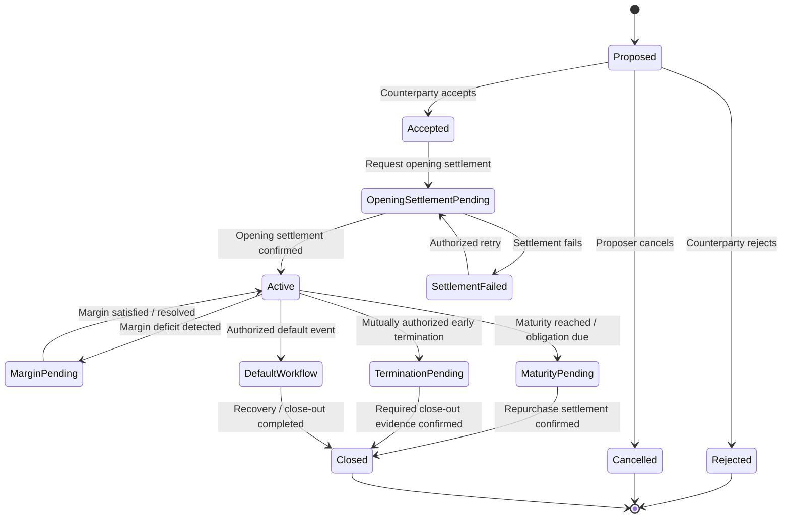

The state machine is a business-level view. It should not be implemented as a single freely editable status field. Use contracts and choices that enforce legal transitions, with separate contracts for external settlement and margin events. Time passage alone does not automatically execute a Daml choice; a scheduled service or authorized actor must submit the command when due.

### 5.5 Choice design matrix

| Choice | Proposed controller | Preconditions | Result |
|---|---|---|---|
| `Accept` | Proposed counterparty | Proposal active; terms valid; counterparty authorized | Create accepted agreement |
| `Reject` | Proposed counterparty | Proposal active | Record rejection / archive proposal |
| `Cancel` | Proposer | Proposal not accepted | Cancel proposal |
| `RequestOpeningSettlement` | Party or jointly authorized workflow role | Agreement accepted; collateral and settlement details valid | Create opening settlement instruction |
| `RecordSettlementEvidence` | Authorized adapter party or designated settlement role | Instruction exists; evidence passes validation | Create evidence and advance workflow where permitted |
| `RequestSubstitution` | Party permitted by agreement | Replacement asset eligible; no conflicting pending action | Create substitution request |
| `ApproveSubstitution` | Counterparty / agent per mandate | Request valid; concentration and coverage constraints pass | Replace allocation version |
| `RaiseMarginCall` | Authorized risk service party | Fresh valuation and calculation available | Create margin-call contract |
| `DisputeMarginCall` | Receiving party | Margin call open and within dispute window | Record dispute and supporting reference |
| `SatisfyMarginCall` | Authorized settlement workflow | Sufficient verified collateral/cash evidence | Mark call satisfied via state transition |
| `RequestMaturitySettlement` | Authorized lifecycle actor | Maturity obligation due; no blocking state | Create closing settlement instruction |
| `ConfirmClosure` | Parties / authorized settlement workflow | Required payment and asset-return evidence available | Create termination record and close lifecycle |

**Important:** an “adapter party” must not be treated as trustworthy merely because it is a Daml party. Its keys, hosting, command rights, data validation, operational controls, and external source authentication are part of the trust design.

### 5.6 Illustrative contract relationship

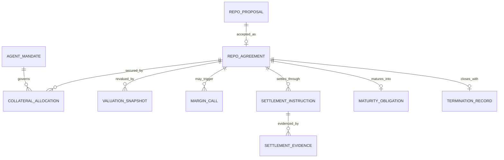

This ER diagram is conceptual. Daml does not use relational foreign keys in the same way as a SQL database. Store contract IDs only when the workflow and visibility model make that reference valid, and design explicit lifecycle links rather than relying on a centralized database join.

---

## 6. Core domain model

### 6.1 Repo terms

`RepoTerms` should capture, at minimum:

- Product type and market convention identifier.
- Cash principal and currency.
- Repo rate, rate type, and day-count convention.
- Trade date, opening value date, maturity date and applicable calendar.
- Repurchase amount or enough validated inputs to calculate it deterministically.
- Collateral basket or named instruments, eligible asset classes, currency rules and concentration limits.
- Haircut / margin convention and rounding policy.
- Margin frequency, threshold, minimum transfer amount and dispute window where applicable.
- Settlement system identifiers and settlement cut-off conventions.
- Governing master agreement reference, annex/schedule reference and legal-entity identifiers.
- Terms version and approval provenance.

Use integer minor units or a well-defined decimal strategy for monetary amounts. Avoid binary floating-point for financial calculations. Currency minor-unit handling and instruments with nonstandard precision must be explicitly supported.

### 6.2 Collateral line

A collateral line should identify:

- Instrument ID (ISIN or a controlled internal identifier).
- Quantity or nominal amount and unit.
- Instrument currency and valuation currency.
- Price and price source reference.
- Accrued interest treatment, if applicable.
- Haircut / margin factor.
- Eligibility and concentration classification.
- Custody account or location reference where permitted.
- Allocation status and evidence of control/settlement.
- Valuation timestamp and freshness limit.

An asset identifier in a contract does not, by itself, prove ownership, custody, absence of encumbrances, or legal perfection. These facts need reliable external evidence and an enforceable asset-control design.

### 6.3 Valuation and haircuts

For a simple illustrative repo calculation:

`Repurchase Amount = Principal × (1 + Rate × AccrualDays / DayCountBasis)`

For a simple haircut model:

`Required Collateral Market Value = Cash Exposure / (1 - Haircut)`

For example, a cash exposure of ₹100 crore and a 2% haircut require approximately ₹102.0408 crore of collateral market value under this convention.

These formulas are not universal market rules. The application must specify whether a convention uses haircut, margin ratio, or another formula; how accrued interest and FX are handled; and which price source, calendar, day count, and rounding rule apply.

### 6.4 Status enums

Prefer narrowly defined enumerations over arbitrary free-form status strings. Example conceptual values:

- Agreement: `Proposed`, `Accepted`, `Rejected`, `Cancelled`, `Active`, `MaturityPending`, `TerminationPending`, `DefaultWorkflow`, `Closed`.
- Settlement: `Prepared`, `Submitted`, `Acknowledged`, `Settled`, `Failed`, `Cancelled`, `ReconciliationRequired`.
- Margin: `Open`, `Disputed`, `PartiallySatisfied`, `Satisfied`, `Expired`, `Cancelled`.
- Collateral allocation: `Proposed`, `Allocated`, `SubstitutionPending`, `Released`, `ReconciliationRequired`.

Do not reuse one status enum across domains. A repo can be active while one margin call is open; a settlement instruction can fail without automatically closing the agreement.

---

## 7. Repo lifecycle

### 7.1 New trade sequence

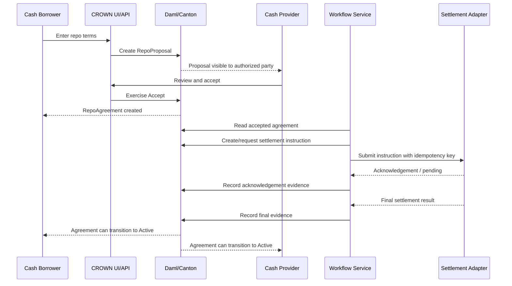

### 7.2 Pre-trade validation

Before accepting or activating a trade, validate:

1. Parties are onboarded and authorized for the product.
2. Trade terms use supported currencies, conventions, calendars, and rate types.
3. Start date and maturity date are valid.
4. Repurchase amount is deterministically derived or checked against an approved calculation.
5. Collateral eligibility, concentration, valuation freshness, and haircut rules pass.
6. Asset availability and encumbrance evidence are current.
7. Settlement instructions contain required identifiers and cut-off information.
8. Required legal agreement references and approvals are present.
9. No duplicate client request or conflicting lifecycle operation exists.

Business validation in the API improves usability, but critical invariants must also be enforced by Daml contract constraints and choice logic where they can be expressed on-ledger.

### 7.3 Opening settlement

The DApp creates a settlement instruction describing the intended cash and securities legs. The adapter submits the instruction to the appropriate external system and records acknowledgements and final evidence.

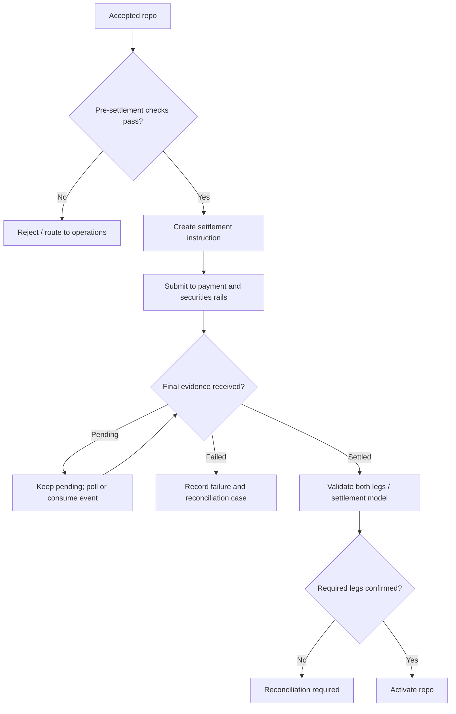

The “both legs confirmed” rule is a simplified bilateral workflow. Real DvP behavior depends on the settlement system, asset/cash representation, and supported atomicity. Do not mark the repo active on an adapter's unverified “success” response.

### 7.4 Maturity

At maturity:

1. Calculate or validate the repurchase amount using the contract's agreed convention.
2. Confirm that no open margin dispute or blocking lifecycle condition prevents the action.
3. Create a closing settlement instruction.
4. Submit the cash repayment and collateral return/release legs.
5. Validate final evidence and reconcile quantities and amounts.
6. Close the agreement only when the required closing conditions are satisfied.
7. Preserve relevant evidence references for reporting and audit.

A maturity scheduler should be idempotent. Repeated execution must not create multiple closing obligations or duplicate payment requests.

---

## 8. Collateral and margin workflows

### 8.1 Collateral allocation

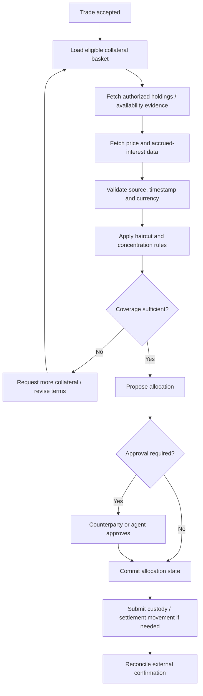

### 8.2 Margin call

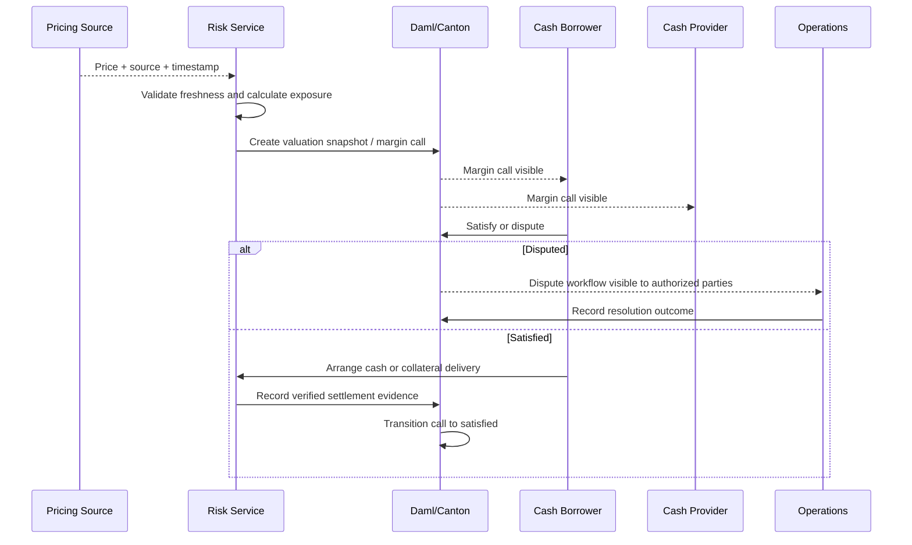

Margin calls must be calculated from trusted, fresh inputs and the contractual margin method. A Daml contract can enforce the accepted result and workflow but cannot independently verify an external price feed without a trusted integration design.

### 8.3 Substitution

1. Requesting party proposes replacement collateral.
2. The application checks replacement eligibility and calculates post-substitution coverage.
3. The counterparty or authorized tri-party agent approves according to the agreement.
4. The workflow submits the required custody movements.
5. Old collateral is not treated as released until the relevant external evidence is validated.
6. New allocation state and evidence are reconciled.
7. If only one leg settles, raise an exception and follow the agreed recovery process.

### 8.4 Double-pledging and asset uniqueness

A Daml contract can prevent conflicting allocations only within the scope of state that the contract model can actually coordinate. If the same security can be pledged outside CROWN, or if different applications use unrelated asset contracts, CROWN cannot claim network-wide prevention without an integrated, authoritative asset-control mechanism.

Use one of the following patterns, chosen explicitly:

- An authoritative on-ledger asset/position representation with enforced transfer/encumbrance choices.
- A custody or collateral-management system as the source of truth, with authenticated confirmations and reconciliation.
- A controlled asset registry integrated with all relevant allocation paths.

A simple `ISIN + quantity` record is not sufficient to establish exclusive control of fungible securities.

---

## 9. Settlement architecture

### 9.1 Adapter boundary

Define a stable adapter interface between CROWN workflows and external infrastructure:

- `prepareInstruction`
- `submitInstruction`
- `getInstructionStatus`
- `cancelInstruction` (only where the rail supports it)
- `verifyEvidence`
- `reconcilePosition`
- `handleInboundEvent`

The exact API contract depends on the payment rail, CSD/custodian, tokenized cash system, and tokenized securities application.

### 9.2 Outbox/inbox and idempotency

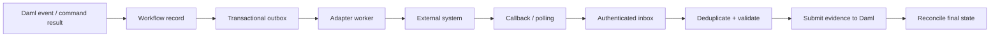

Use an idempotency key derived from a stable business identifier and operation version, not a random new key on every retry. Store adapter attempts, external references, request hashes, timestamps, and response classifications. Never retry a non-idempotent payment blindly.

### 9.3 Settlement states

Keep the external instruction state independent from repo state.

| State | Meaning |
|---|---|
| `Prepared` | CROWN has validated the proposed instruction |
| `Submitted` | Adapter sent the request |
| `Acknowledged` | External system accepted it for processing |
| `Pending` | No final outcome yet |
| `Settled` | Authoritative final settlement evidence validated |
| `Failed` | External system reports final failure |
| `Cancelled` | Cancellation was confirmed where supported |
| `ReconciliationRequired` | Inconsistent, partial, late or ambiguous evidence requires operations |

### 9.4 Tokenized assets

If cash and securities are represented by tokenized assets on Canton, settlement may be coordinated with the relevant asset contracts if the applications support compatible atomic transaction composition and authorization. If cash is moved through a conventional bank rail and securities through a separate custodian, use explicit pending states, final confirmations, and reconciliation controls. Do not describe a cross-system workflow as atomic unless the underlying systems guarantee it.

---

## 10. Privacy and authorization model

### 10.1 Contract visibility

Daml stakeholders (signatories and observers) can see the relevant contracts. This is a core privacy control, not merely a UI filter.

Suggested default visibility:

| Contract | Borrower | Cash provider | Agent | Custodian | Auditor |
|---|---:|---:|---:|---:|---:|
| Bilateral proposal/agreement | Yes | Yes | Only if needed | No by default | Explicit grant |
| Collateral allocation | Yes | Yes | If mandated | If servicing it | Explicit grant |
| Valuation snapshot | Yes | Yes | If mandated | If needed | Explicit grant |
| Margin call | Yes | Yes | If mandated | No by default | Explicit grant |
| Settlement instruction | Relevant parties | Relevant parties | If involved | Yes for its leg | Explicit grant |
| Custody evidence | Relevant parties | Relevant parties | If mandated | Yes | Explicit grant |
| CCP submission | Clearing members / CCP as required | As permitted | As permitted | As needed | Explicit grant |

This table is a starting policy, not a universal market rule. An observer should not be added simply to make dashboards convenient. Provide authorized reporting through a controlled backend when full contract visibility is not appropriate.

### 10.2 Authorization layers

1. **Enterprise identity:** SSO/OIDC, MFA, user lifecycle and organization membership.
2. **Application authorization:** role-based and attribute-based controls for products, portfolios, legal entities and limits.
3. **Party authorization:** bind authenticated users to the correct Daml party or delegated party.
4. **Daml authorization:** signatories, controllers, observers, ensure clauses, keys and choice logic.
5. **Integration authorization:** service identities, mTLS, narrowly scoped credentials, signed callbacks where supported.
6. **Operations authorization:** separate deployment, package vetting, participant administration, data access and break-glass roles.

A UI permission check is never sufficient. The Daml controller and signatory model must independently prevent unauthorized state transitions.

### 10.3 Privacy threat model

| Threat | Control |
|---|---|
| Bank sees another bank's unrelated trades | Need-to-know stakeholders; separate contracts; authorized read APIs |
| User submits as wrong institution | Strong identity-to-party mapping and server-side entitlement checks |
| Adapter forges settlement status | Authenticated source, signed/verified evidence where supported, reconciliation |
| Operator accesses unnecessary data | Least privilege, segregated duties, audited access, data minimization |
| Duplicate command creates duplicate external movement | Idempotency keys, inbox/outbox, reconciliation |
| Stale price produces incorrect margin | Freshness policy, source metadata, validation, dispute path |
| Compromised service credential | Secret manager, rotation, workload identity, revocation and monitoring |
| Package upgrade changes semantics | Reviewed package versions, tests, controlled vetting and migration plan |

---

## 11. Product extensions

### 11.1 Tri-party repo

Add an `AgentMandate` defining:

- Principal parties and agent identity.
- Permitted asset classes and eligible basket rules.
- Haircut and concentration policy version.
- Allocation and substitution authority.
- Valuation source requirements and revaluation frequency.
- Fees, operational cut-offs and exception routing.
- Delegation, termination and mandate versioning.

The agent may allocate collateral only within its mandate. Trade economics and bilateral obligations should remain controlled by the counterparties unless the legal arrangement explicitly delegates more authority.

### 11.2 GCF-style repo

Before implementation, document the exact target market and rulebook. Requirements may include:

- Standardized collateral baskets.
- Clearing-member or dealer eligibility.
- Trade submission and matching.
- Netting sets and eligible obligations.
- Clearing-house or service-provider integration.
- Settlement conventions and operational cut-offs.
- Rejection, correction, and reconciliation workflows.

Do not infer that a generic basket contract reproduces a named market's GCF product.

### 11.3 Securities lending / borrowing

Model a loan of securities with:

- Lender and borrower.
- Instrument, quantity and delivery evidence.
- Loan fee and accrual convention.
- Collateral type, valuation and haircut.
- Recall, return, substitution and corporate-action workflows.
- Manufactured payments where legally and operationally applicable.
- Failure-to-deliver and default workflows.

Lending and borrowing are usually opposite perspectives on the same transaction. Prefer one shared loan agreement with role-specific views rather than duplicating independent agreements.

### 11.4 Buy/sell-back

Model an initial sale leg and a future repurchase leg, with explicit terms and settlement evidence for each leg. Legal characterization, accrued-interest treatment, coupon handling, and close-out differ across jurisdictions and agreements; obtain market-specific legal review.

### 11.5 Collateralized short-term loan

Model loan principal, rate, repayment schedule, collateral pledge, valuation, covenant breach, release and default. The system must not imply that a tokenized record alone perfects a security interest or creates enforceable collateral rights.

### 11.6 CCP-connected repo

Treat clearing as a separate integration and legal workflow:

- Clearing submission and acknowledgement.
- Acceptance, rejection, correction and novation evidence.
- Clearing-member and CCP roles.
- Initial/variation margin obligations as applicable.
- Position and netting-set references.
- Default and close-out processes under the CCP's rules.
- Reconciliation between CROWN and the clearing system.

CROWN must not claim to be a CCP unless it is legally authorized and operationally constituted as one.

---

## 12. Backend and API design

### 12.1 Service boundaries

A possible service layout:

- `identity-service`: SSO, organization membership, user-to-party mapping.
- `trade-service`: proposal creation, acceptance commands, trade validation.
- `collateral-service`: asset eligibility, allocation and substitution workflows.
- `risk-service`: valuation ingestion, haircuts, exposure and margin calculations.
- `settlement-orchestrator`: outbox/inbox, retries, reconciliation and rail adapters.
- `ledger-gateway`: typed command submission and contract queries.
- `read-model-service`: dashboards, search and reporting projections.
- `notification-service`: email, in-app notifications and escalation.
- `audit-service`: authorized evidence references and access records.

Start as a modular monolith unless independent scaling, ownership or security boundaries justify microservices. More services create more distributed failure modes.

### 12.2 Example REST endpoints

These are proposed API routes, not implemented endpoints.

| Method | Route | Purpose |
|---|---|---|
| `POST` | `/api/v1/repos/proposals` | Create repo proposal |
| `GET` | `/api/v1/repos` | List repos visible to caller |
| `GET` | `/api/v1/repos/{repoId}` | Read authorized repo details |
| `POST` | `/api/v1/repos/{repoId}/accept` | Accept proposal |
| `POST` | `/api/v1/repos/{repoId}/reject` | Reject proposal |
| `POST` | `/api/v1/repos/{repoId}/settlement-instructions` | Request settlement |
| `GET` | `/api/v1/settlements/{instructionId}` | Read instruction status |
| `POST` | `/api/v1/settlements/{instructionId}/evidence` | Ingest authenticated evidence |
| `POST` | `/api/v1/repos/{repoId}/collateral/substitutions` | Request substitution |
| `POST` | `/api/v1/margin-calls/{marginCallId}/disputes` | Dispute margin call |
| `POST` | `/api/v1/margin-calls/{marginCallId}/satisfaction` | Record satisfaction evidence |
| `POST` | `/api/v1/repos/{repoId}/maturity-settlement` | Initiate closing settlement |
| `GET` | `/api/v1/operations/exceptions` | List exceptions visible to operator |

### 12.3 API requirements

- Use OIDC/OAuth2 with enterprise SSO and MFA.
- Apply organization and portfolio authorization to every query and command.
- Validate request schemas and reject unknown or invalid economic fields.
- Use idempotency keys on command endpoints that can trigger external side effects.
- Return correlation IDs and stable business IDs.
- Do not expose raw participant credentials, private signing material, or unrestricted ledger APIs.
- Do not trust client-supplied party IDs without validating them against the authenticated user's entitlements.
- Keep error messages informative but avoid leaking another institution's contract existence.
- Use pagination, bounded query windows, rate limits and audit logs.
- Version APIs and Daml packages independently with compatibility tests.

---

## 13. Data and event flows

### 13.1 Command path

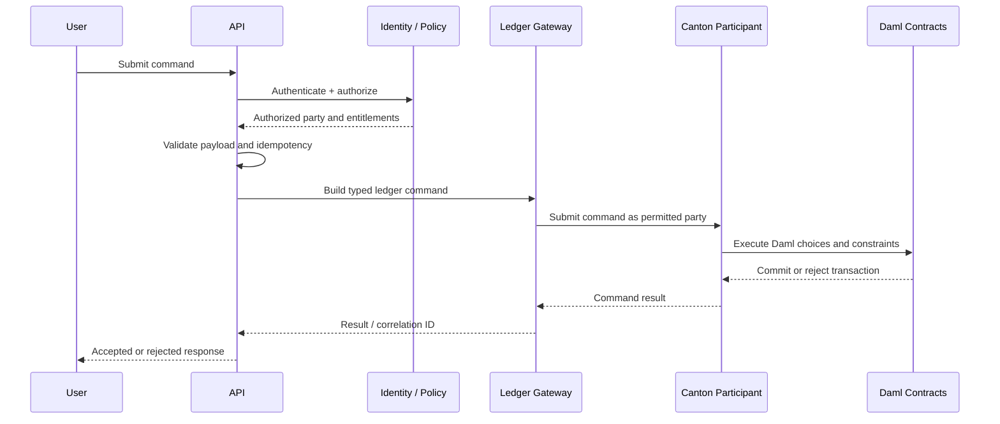

### 13.2 Read path

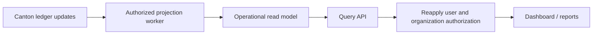

A read model is a projection for efficient queries; it is not the authoritative contractual record. Enforce authorization at the query API because a SQL store does not automatically inherit Daml's stakeholder visibility rules.

### 13.3 Event envelope

For application-level events, include fields such as:

- `eventId`
- `eventType`
- `schemaVersion`
- `occurredAt`
- `correlationId`
- `causationId`
- `businessReference`
- `sourceSystem`
- `payloadReference` or minimized payload
- `integrityHash` where appropriate

Do not publish confidential contract payloads to a broad event bus. Route only the data each consumer is entitled to receive.

---

## 14. Failure handling and recovery

| Failure | Expected behavior |
|---|---|
| Counterparty never accepts proposal | Expire/cancel through an authorized lifecycle action or operational process |
| Settlement adapter times out | Keep pending; query external status before retrying |
| Duplicate callback | Deduplicate by stable external reference and idempotency key |
| Payment settles but securities leg fails | Enter reconciliation/exception workflow; do not falsely mark DvP complete |
| Stale price | Reject or quarantine valuation; request a fresh authorized price |
| Margin disputed | Keep dispute open; follow contractual dispute window and escalation path |
| Replacement collateral fails to settle | Preserve old collateral state until release conditions are met; reconcile both legs |
| Maturity command runs twice | Enforce one active maturity obligation / idempotent operation key |
| Ledger command rejected | Surface a safe error; do not retry deterministic validation failures endlessly |
| Participant or synchronizer unavailable | Queue permitted work safely; do not claim ledger commit before confirmation |
| External system sends contradictory evidence | Freeze affected transition and route to reconciliation |
| Unauthorized user requests contract | Deny without leaking protected details |

### Exception-management workflow

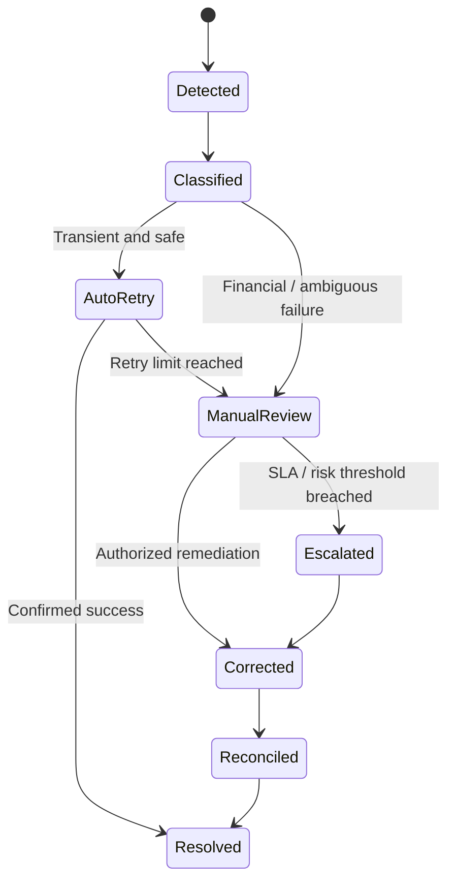

Do not automatically compensate a financial transaction unless the external rail and legal agreement support that operation. A compensating business event is not always the same as reversing a payment or securities movement.

---

## 15. Security architecture

### 15.1 Minimum baseline

- TLS for all network connections; mTLS for service-to-service and adapter connections where supported.
- SSO/OIDC, MFA, short-lived access tokens and session controls.
- Workload identity or managed identities for services.
- Secrets stored in a managed secret service; no secrets in source control, images, logs or Daml payloads.
- Least-privilege IAM, participant permissions and package vetting.
- Segregation of duties for onboarding, trade operations, package release and production administration.
- Signed builds, dependency scanning, SBOM generation and artifact provenance.
- Immutable operational audit trails with restricted access and retention controls.
- Encryption at rest and key rotation under institution policy.
- Network segmentation, private endpoints and egress restrictions.
- Rate limiting, abuse detection and alerting.
- Incident response, key compromise, participant compromise and recovery runbooks.

### 15.2 Secrets and key management

- Do not store private keys or credentials in Daml contracts.
- Prefer hardware-backed or managed key protection where available and appropriate.
- Define key rotation, revocation, recovery and dual-control procedures.
- Separate application API credentials from Canton identity keys and external settlement credentials.
- Test key compromise and credential revocation scenarios.

### 15.3 Operational controls

Production readiness requires threat modeling, penetration testing, independent contract review, reconciliation testing, disaster recovery exercises, data retention policies, business continuity procedures, and institution-specific security approval.

---

## 16. Testing strategy

### 16.1 Daml contract tests

Test both allowed and forbidden transitions:

- Proposal created by authorized party.
- Only intended counterparty can accept or reject.
- Invalid terms fail creation or acceptance.
- Unauthorized party cannot exercise a choice.
- Expired/cancelled proposal cannot be accepted.
- Settlement evidence must match the instruction and required status.
- Repo cannot become active before required opening settlement conditions pass.
- Collateral does not satisfy coverage if its valuation is stale or asset is ineligible.
- Margin dispute and satisfaction transitions follow the agreed rules.
- Substitution does not release old collateral prematurely.
- Maturity cannot create duplicate obligations.
- Closure requires required final settlement evidence.
- Observers cannot exercise unauthorized choices.
- Different trades remain private to their intended stakeholders.

### 16.2 Property and scenario tests

- Interest calculation across day-count conventions and date boundaries.
- Rounding and currency minor-unit behavior.
- Haircut boundary values, including zero and invalid values.
- Large amounts and overflow boundaries.
- FX conversion and stale prices if FX collateral is supported.
- Repeated commands and duplicate callbacks.
- Concurrent substitutions and allocation attempts.
- Partial settlement and out-of-order events.
- Time-zone, business-day and holiday calendar behavior.
- Package upgrade compatibility and existing-contract migration.

### 16.3 Integration tests

Use a simulated adapter first, then test against vendor sandboxes:

- Payment request / final status lifecycle.
- Securities settlement request / final status lifecycle.
- Authenticated callback verification.
- Timeout and retry behavior.
- External status polling.
- Reconciliation between external balances and CROWN allocations.
- Recovery after worker, database, API or participant outage.

### 16.4 Test pyramid

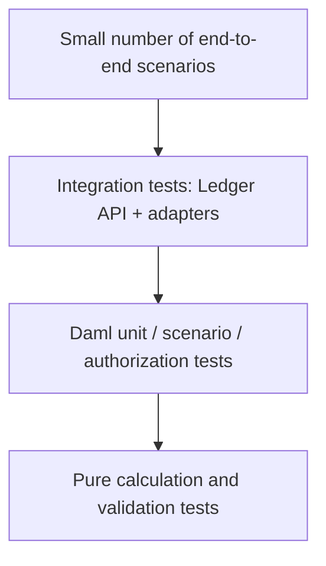

The diagram represents increasing test volume toward the bottom, not a rule that all tests must be written in a specific order.

---

## 17. Repository layout

A suggested monorepo:

```text
crown/
├── README.md
├── LICENSE
├── SECURITY.md
├── CONTRIBUTING.md
├── .gitignore
├── .editorconfig
├── docs/
│   ├── architecture/
│   │   ├── system-context.md
│   │   ├── contract-map.md
│   │   ├── privacy-model.md
│   │   ├── settlement-model.md
│   │   └── threat-model.md
│   ├── decisions/
│   │   ├── ADR-001-mediated-backend.md
│   │   ├── ADR-002-settlement-adapter.md
│   │   └── ADR-003-contract-visibility.md
│   ├── runbooks/
│   │   ├── settlement-exception.md
│   │   ├── stale-pricing.md
│   │   └── key-compromise.md
│   └── product/
│       ├── bilateral-repo.md
│       ├── tri-party-repo.md
│       └── securities-lending.md
├── daml/
│   ├── daml.yaml
│   ├── Main.daml
│   └── Crown/
│       ├── Types.daml
│       ├── ReferenceData.daml
│       ├── Repo/
│       │   ├── Agreement.daml
│       │   └── Lifecycle.daml
│       ├── Collateral.daml
│       ├── Valuation.daml
│       ├── Margin.daml
│       ├── Settlement.daml
│       ├── TriParty.daml
│       ├── SecuritiesLending.daml
│       ├── BuySellBack.daml
│       ├── Clearing.daml
│       └── Audit.daml
├── backend/
│   ├── src/
│   ├── tests/
│   ├── Dockerfile
│   └── README.md
├── frontend/
│   ├── src/
│   ├── tests/
│   └── README.md
├── adapters/
│   ├── common/
│   ├── payment-simulator/
│   ├── custody-simulator/
│   └── pricing-simulator/
├── infra/
│   ├── local/
│   ├── containers/
│   ├── helm/
│   └── terraform/
├── scripts/
├── test/
│   ├── integration/
│   ├── performance/
│   └── security/
└── .github/
    └── workflows/
```

Adjust this structure to the selected SDK and backend stack. The sample tree is a proposal, not a generated repository.

---

## 18. Local development and build workflow

### 18.1 Prerequisites

- A supported Daml SDK / DPM version compatible with the target Canton environment.
- Java and other dependencies required by the selected toolchain.
- Node.js package manager if using the TypeScript frontend/backend.
- Docker or another approved local runtime if used by your local environment.
- Access to a local Canton sandbox or an approved development network.
- Test identities/parties and simulated external systems.

Use the current official installation and quickstart documentation. Do not assume that commands or configuration options are identical across Daml SDK and Canton versions.

### 18.2 Initialize a Daml project

Follow the currently supported project initialization flow in the official documentation. A typical workflow is:

```bash
# Create or initialize the Daml project using the command
# supported by the installed Daml SDK / DPM version.
dpm new --help

# Inspect project configuration and source files.
# Then build from the Daml project directory.
dpm build
```

The exact `dpm new` syntax depends on the installed tool version and command form. Check `dpm new --help` rather than copying an unverified command into a production setup.

### 18.3 Development loop

1. Write a small domain type or template.
2. Compile with the supported build command.
3. Add Daml tests for authorization and state transitions.
4. Run tests locally.
5. Inspect the generated DAR and package metadata.
6. Deploy to a disposable local Canton environment.
7. Exercise commands through the Ledger API.
8. Test participant visibility with different party identities.
9. Test the adapter with deterministic simulated responses.
10. Run security and integration tests before promoting a build.

### 18.4 Environment separation

Maintain separate configurations for:

- `local`: developer sandbox and fake counterparties.
- `test`: CI environment and deterministic adapter simulators.
- `uat`: controlled integration with vendor sandboxes.
- `prod`: approved participant topology, secrets, external rails, monitoring and operational procedures.

Never reuse production signing material in local or CI environments.

---

## 19. Deployment model

### 19.1 Logical deployment

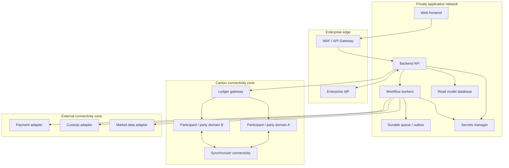

This is a logical model. A real topology may be institution-operated, managed, multi-region, multi-synchronizer, or connected through other approved arrangements. Do not assume that every participant is operated by CROWN.

### 19.2 Release pipeline

1. Code review and protected branch.
2. Static analysis and dependency scanning.
3. Daml build and contract tests.
4. Backend/frontend tests.
5. Adapter contract tests and deterministic integration tests.
6. DAR/package inspection and artifact signing.
7. Deploy to a test environment.
8. Run migration, compatibility, privacy and operational checks.
9. Obtain authorized release approval.
10. Promote immutable artifacts; do not rebuild different bits for production.
11. Confirm package vetting and participant configuration.
12. Run post-deployment smoke tests and reconciliation checks.

### 19.3 Upgrades

- Version financial terms and policy contracts.
- Define compatibility requirements for existing active agreements.
- Do not assume changing a source template automatically upgrades active contracts.
- Test package vetting and upgrade paths on representative existing state.
- Define how active trades continue under their original terms.
- Keep migration, rollback and emergency release plans.

---

## 20. Observability and operations

### 20.1 Metrics

Track at least:

- Trade proposals created, accepted, rejected and cancelled.
- Time from proposal to acceptance.
- Opening and closing settlement success/failure rates.
- Pending settlement age and reconciliation backlog.
- Margin calls open, disputed and overdue.
- Stale valuation count and pricing source latency.
- Collateral coverage breaches and concentration exceptions.
- Ledger command failures by safe error category.
- Adapter retries, timeouts, duplicate events and dead-letter volume.
- API latency, error rate and authentication failures.
- Worker lag and read-model projection lag.

Do not place full trade terms, account numbers, or personal data in metric labels.

### 20.2 Correlation and audit

Use a correlation ID across UI, API, workflow worker, ledger command, adapter request, and external reference. Record who initiated an action, which party authorized it, the relevant contract/instruction reference, timestamps, and outcome. Protect logs from unauthorized modification and define retention based on legal and institutional requirements.

### 20.3 Operational dashboards

- Trade lifecycle dashboard.
- Settlement queue and failed-leg dashboard.
- Collateral eligibility and coverage dashboard.
- Margin-call and dispute dashboard.
- Stale-price and source-health dashboard.
- External reconciliation dashboard.
- Participant / API health dashboard.
- Access-control and privileged-action dashboard.

### 20.4 Service-level objectives

Define SLOs with counterparties and providers rather than inventing universal numbers. Include availability, command response time, event-processing lag, settlement-status freshness, reconciliation completion, and incident response. Settlement finality depends on external infrastructure and its operating calendar, not only CROWN uptime.

---

## 21. Roadmap and acceptance criteria

### Phase 0 — Domain and legal discovery

- Select target jurisdiction and market conventions.
- Identify master agreement and collateral legal framework.
- Define whether assets are simulated, tokenized, or held in conventional custody.
- Document privacy, party roles, legal entities, and settlement finality assumptions.
- Agree on supported calendars, currencies, day-count conventions, and rounding.

**Exit criteria:** reviewed domain model, state machine, threat model, and explicit assumptions.

### Phase 1 — Bilateral repo MVP

- Proposal and acceptance.
- Agreement with validated economic terms.
- Basic collateral allocation model.
- Simulated opening and closing settlement adapters.
- Maturity obligation and termination flow.
- Daml tests for controllers, signatories, privacy and invalid transitions.

**Exit criteria:** two test parties can complete a full simulated lifecycle, and negative authorization tests pass.

### Phase 2 — Collateral and margin

- Valuation snapshots with source/time metadata.
- Eligibility and concentration rules.
- Haircut and coverage calculations.
- Margin calls, disputes and satisfaction.
- Collateral substitution workflow.
- Concurrent allocation and stale-data tests.

**Exit criteria:** reproducible calculations, auditable valuation lineage, and tested failure recovery.

### Phase 3 — Institutional integration

- Enterprise identity and party mapping.
- Ledger API gateway.
- Durable outbox/inbox and idempotent adapters.
- Vendor sandbox integration.
- Read model and operational dashboards.
- Reconciliation and incident runbooks.

**Exit criteria:** integration tests demonstrate safe retries, duplicate handling, partial-failure recovery and external reconciliation.

### Phase 4 — Tri-party and securities lending

- Agent mandates and scoped authority.
- Basket allocation and substitutions.
- Securities loan, fee, recall and return.
- Corporate-action and manufactured-payment requirements if in scope.

**Exit criteria:** independent tests cover agent authority and role-specific privacy.

### Phase 5 — Clearing and market-specific workflows

- Market-specific GCF-style rulebook mapping.
- CCP submission, acceptance and rejection integration.
- Clearing member roles and margin.
- Netting, default and close-out workflows under applicable rules.

**Exit criteria:** legal, operational, integration, security and regulatory reviews are complete for the intended deployment.

---

## 22. Risks and limitations

1. **Legal characterization:** repo, title transfer, pledge, securities lending and buy/sell-back treatment differ by jurisdiction and documentation.
2. **Settlement finality:** a ledger record is not automatically proof of final cash or securities settlement.
3. **External asset control:** preventing double pledge requires authoritative asset control or integrated custody evidence.
4. **Data quality:** incorrect prices, calendars, accrued interest or security identifiers can create incorrect collateral coverage.
5. **Privacy:** Daml stakeholder choices must be designed deliberately; backend query services must enforce their own access controls.
6. **Operational complexity:** asynchronous payment and custody systems can fail independently.
7. **CCP complexity:** novation, netting, membership, margin, default funds and close-out require market-specific implementation.
8. **Interoperability:** cross-application atomic settlement is only available where the participating applications and assets support it.
9. **Regulation:** operating the platform may trigger licensing, outsourcing, data protection, recordkeeping, market infrastructure or other obligations depending on the business model and jurisdiction.
10. **Upgrade safety:** active financial agreements may need to retain the original conventions and package semantics.

CROWN is infrastructure software in this design. It does not itself become a regulated intermediary merely by being described as infrastructure, and an “infrastructure-only” business model does not automatically remove licensing or compliance obligations. Obtain jurisdiction-specific legal and regulatory advice.

---

## 23. Glossary

- **Canton:** A privacy-aware interoperability and distributed-ledger platform.
- **Daml:** A language and programming model for multi-party business workflows and contracts.
- **Participant:** A Canton node that hosts parties and processes their ledger transactions.
- **Synchronizer:** Canton infrastructure that coordinates transaction sequencing and confirmation among connected participants.
- **Party:** A ledger identity used in contract authorization and visibility.
- **Signatory:** A party whose authorization is required to create a contract and assume its modeled obligations.
- **Observer:** A stakeholder that can see a contract but does not necessarily control its choices.
- **Controller:** A party authorized to exercise a particular choice.
- **DAR:** A packaged Daml application artifact.
- **Repo:** A transaction involving sale/transfer of securities with an agreement to repurchase equivalent securities later, subject to applicable market/legal terms.
- **Reverse repo:** The cash investor's perspective of a repo transaction.
- **Haircut:** A margin applied to collateral value or exposure under a specified convention.
- **Tri-party agent:** A third party that performs collateral-management functions under an agreed mandate.
- **DvP:** Delivery-versus-payment, a settlement arrangement linking securities delivery and cash payment.
- **CCP:** Central counterparty that interposes itself between counterparties under its rules and legal framework.
- **Read model:** A query-optimized projection of authoritative business events or ledger state.
- **Idempotency:** A property where repeating the same operation does not duplicate its business effect.

---

## 24. References

Use the documentation matching the exact Daml SDK, Canton version, and deployment environment selected for the project.

- [Daml and Canton getting started](https://docs.digitalasset.com/build/3.5/tutorials/get-started/index.html)
- [Canton application architecture design considerations](https://docs.digitalasset.com/build/3.4/sdlc-howtos/system-design/daml-app-arch-design.html)
- [Canton Network quickstart project structure](https://docs.digitalasset.com/build/3.5/quickstart/configure/project-structure-overview.html)
- [Daml template reference](https://docs.digitalasset.com/build/3.4/reference/daml/templates.html)
- [Daml template structure and choices](https://docs.digitalasset.com/build/3.4/reference/daml/structure.html)
- [Parties and users on a Canton ledger](https://docs.digitalasset.com/build/3.4/explanations/parties-users.html)
- [Canton participant overview](https://docs.digitalasset.com/operate/3.4/overview/index.html)

---

## Project status

CROWN is a proposed reference architecture and project blueprint. The module names, APIs, diagrams and workflows in this README are design artifacts; they do not imply that corresponding source files, external integrations, production controls, legal opinions, or regulatory approvals have already been implemented.

**Recommended first milestone:** implement and test `RepoProposal`, `RepoAgreement`, `SettlementInstruction`, `SettlementEvidence`, and `MaturityObligation` for a bilateral repo using simulated external rails. Only then extend into collateral optimization, tri-party mandates and clearing workflows.