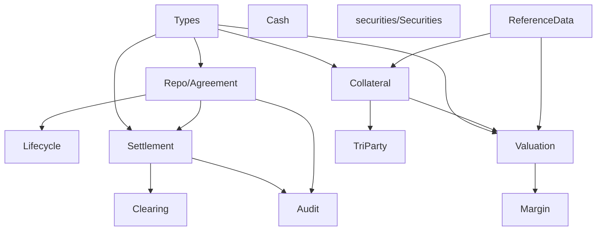

# CROWN DAML module reference

This document explains every DAML module in the package and maps it to the business purpose defined in the architecture.

## 1. Shared domain modules

### Types
File: `daml/Types/Types.daml`

Purpose:
- Shared domain enums and records for repo economics and lifecycle state.
- Central contract vocabulary used by agreement, settlement, margin, and valuation modules.

Key concepts:
- `AgreementStatus`: proposed, accepted, active, maturity pending, closed, etc.
- `SettlementStatus`: prepared, submitted, acknowledged, settled, failed, reconciliation required.
- `MarginStatus`: open, disputed, satisfied, expired.
- `CollateralStatus`: proposed, allocated, substitution pending, released.
- `RepoTerms`: product terms, principal, haircut, maturity, rate, repurchase amount, etc.
- `CollateralLine`: collateral representation and valuation metadata.
- `ExternalEvidenceRef`: external proof reference with source system and hash.

Business meaning:
This is the canonical vocabulary layer. It prevents free-form strings from spreading throughout the repo logic and keeps the ledger model consistent across modules.

---

### Audit
File: `daml/Audit/Audit.daml`

Purpose:
- Stores or references evidence that supports operational review and control testing.
- Keeps audit evidence as metadata rather than exposing full sensitive details on-chain.

Key concepts:
- `EvidenceReference`: source system, evidence type, hash, created time.

Business meaning:
This module is used to preserve traceability for compliance, reconciliation, and post-event investigation without exposing the underlying confidential payload.

---

### Governance
File: `daml/Governance/Governance.daml`

Purpose:
- Captures governance approvals and control artifacts for policy or legal terms.

Key concepts:
- `PolicyApproval`: policy identifier, approver, version, timestamp.

Business meaning:
This gives the bank-grade control layer a place to record policy acceptance and controlled versioning for product rules, collateral policies, and process governance.

---

### Compliance
File: `daml/Compliance/Compliance.daml`

Purpose:
- Holds compliance review metadata and checks.

Key concepts:
- `ComplianceCheck`: check identifier, status, reviewer, remarks.

Business meaning:
This allows KYC/AML, sanctions, or product-specific reviews to be captured as part of the repo or collateral workflow without embedding operational details directly in the trade contract.

---

### Identity
File: `daml/Identity/Identity.daml`

Purpose:
- Records identity information and party relationships relevant to onboarding or legal-entity mapping.

Key concepts:
- `PartyIdentity`: legal entity identifier, party id, and product scope.

Business meaning:
This supports permissioning and role mapping across institutions, ensuring when an institution acts on behalf of a legal entity it can be tied to a verified identity context.

---

### Interfaces
File: `daml/Interfaces/Interfaces.daml`

Purpose:
- Defines adapter-facing request payloads and integration references.

Key concepts:
- `AdapterRequest`: request id, adapter name, payload hash.

Business meaning:
This is the contract boundary for integrating external systems such as settlement rails, market data feeds, or custody providers.

---

### main/Main.daml
File: `daml/main/Main.daml`

Purpose:
- Base application bootstrap or package-level config metadata.

Key concepts:
- `ApplicationConfig`: package name, version, environment.

Business meaning:
The module is a lightweight top-level configuration record used by application bootstrap and deployment awareness, without overriding business logic in the ledger model.

---

## 2. Agreement and lifecycle modules

### Repo/Agreement.daml
File: `daml/Repo/Agreement.daml`

Purpose:
- Main bilateral repo proposal and agreement lifecycle.
- Governs acceptance, opening settlement requests, maturity, closure, and early termination.

Key concepts:
- `RepoProposal`
- `RepoAgreement`
- `OpeningSettlementRequest`

Business logic:
- Proposal must be valid before acceptance.
- Agreement must be accepted before settlement can be requested.
- Active agreements can request maturity or early termination.
- Closure requires supported legal evidence and a valid state transition.

---

### Repo/Lifecycle.daml
File: `daml/Repo/Lifecycle.daml`

Purpose:
- Repository-specific lifecycle helper or extended lifecycle module.

Business meaning:
This file complements the core repo flow and gives the package a dedicated lifecycle boundary that can support event sequencing, extension logic, or a repo-specific operational model without mixing it into the core agreement templates.

---

### Lifecycle/Lifecycle.daml
File: `daml/Lifecycle/Lifecycle.daml`

Purpose:
- Shared lifecycle obligations and termination records that apply across main agreement flows.

Key concepts:
- `MaturityObligation`
- `TerminationRecord`

Business meaning:
When a repo enters maturity, the ledger creates a formal obligation to close out the agreement. The termination record captures the close-out basis and evidence of completion.

---

## 3. Settlement modules

### Settlement/Settlement.daml
File: `daml/Settlement/Settlement.daml`

Purpose:
- Defines settlement instruction and evidence contracts for external movement or reconciliation.

Key concepts:
- `SettlementInstruction`
- `SettlementEvidence`

Business meaning:
An instruction is a request to settle. Evidence is proof that it settled or failed. This separation follows the architecture’s rule that an instruction is not equal to legal proof of settlement.

---

### Cash/Cash.daml
File: `daml/Cash/Cash.daml`

Purpose:
- Captures cash leg details and cash settlement confirmation records.

Key concepts:
- `CashLeg`
- `CashSettlementConfirmation`

Business meaning:
This file focuses on cash movement: account, amount, currency, settlement date, and evidence of payment confirmation.

---

### Securities/Securities.daml
File: `daml/securities/Securities.daml`

Purpose:
- Represents security positions or asset balances relevant to repos and collateral allocations.

Key concepts:
- `SecurityPosition`

Business meaning:
Security positions connect the repo model to the movement and custody of assets used as collateral or settlement assets.

---

### SecuritiesLending/SecuritiesLending.daml
File: `daml/SecuritiesLending/SecuritiesLending.daml`

Purpose:
- Covers securities lending or borrowing mechanisms used in broader secured-funding products.

Key concepts:
- `SecuritiesLoan`

Business meaning:
This module supports the architectural extension beyond straight repo products and is useful when a borrowing or lending program needs explicit fee and collateral treatment.

---

### Clearing/Clearing.daml
File: `daml/Clearing/Clearing.daml`

Purpose:
- Tracks clearing submissions and status of trades passed to a clearing service.

Key concepts:
- `ClearingSubmission`

Business meaning:
This module is for CCP or mandate-based market infrastructure where the trade or collateral must be submitted through a clearing service.

---

## 4. Collateral, valuation, and margin modules

### Collateral/Collateral.daml
File: `daml/Collateral/Collateral.daml`

Purpose:
- Models collateral allocations, substitutions, and release conditions.

Business meaning:
The collateral module keeps the repo agreement connected to the assets that secure the transaction and ensures allocation and release are explicit and reviewable.

---

### Valuation/Valuation.daml
File: `daml/Valuation/Valuation.daml`

Purpose:
- Captures pricing snapshots for collateral and repo exposure.

Business meaning:
A fresh valuation is needed to quantify haircut coverage, margin requirements, and collateral sufficiency. Stale or missing valuation data should block action in the operational workflow.

---

### Margin/Margin.daml
File: `daml/Margin/Margin.daml`

Purpose:
- Models margin calls, disputes, and satisfaction flows.

Business meaning:
Margin events are separated from the repo agreement itself so the model can represent disputed or satisfied calls without conflating them with the underlying trade commitment.

---

### ReferenceData/ReferenceData.daml
File: `daml/ReferenceData/ReferenceData.daml`

Purpose:
- Holds eligibility policies and reference information for collateral and market conventions.

Business meaning:
This module records the rule sets that determine whether an asset is eligible, how much concentration is allowed, and what market or legal convention applies to a repo.

---

### TriParty/TriParty.daml
File: `daml/TriParty/TriParty.daml`

Purpose:
- Models tri-party agent mandates and allocation requests.

Business meaning:
It supports the extension of repo collateral management to an agent or custodian controlled basket model, where an intermediate participant allocates collateral under a mandate.

---

### BuySellBack/BuySellBack.daml
File: `daml/BuySellBack/BuySellBack.daml`

Purpose:
- Represents paired initial sale and repurchase arrangements.

Business meaning:
This product family is closely related to repo but has a different legal and operational treatment. The module allows the package to support sell/buy-back flows without changing the core repo model.

---

## 5. Operational and product extension modules

### Governance and controls summary
The package deliberately separates operational metadata from core contract logic: governance, compliance, identity, and interface modules are not the trade itself; they are the control plane around it.

### Product extension map
The Daml package is designed to support:
- bilateral repo
- tri-party repo
- buy/sell-back
- securities lending
- clearing-linked obligations

These are all built from the same primitives: agreement lifecycle, collateral, valuation, margin, settlement evidence, and governance.

## 6. Dependency map

This diagram is conceptual and does not imply every module must import every other module directly. It shows the intended business relationship among the domains.
