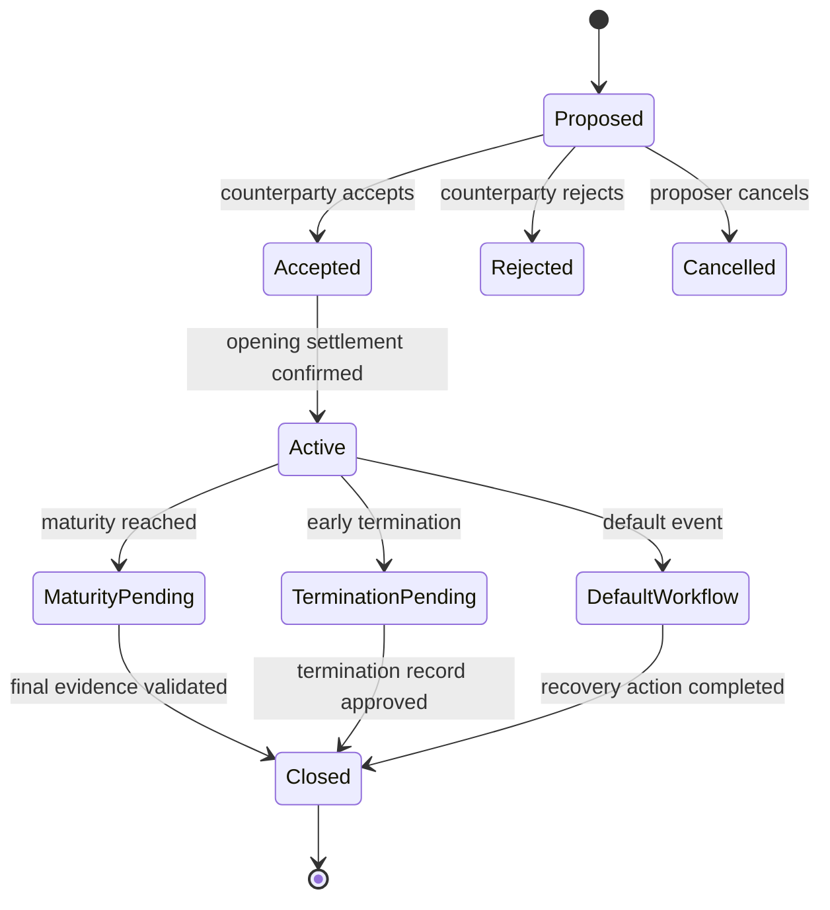
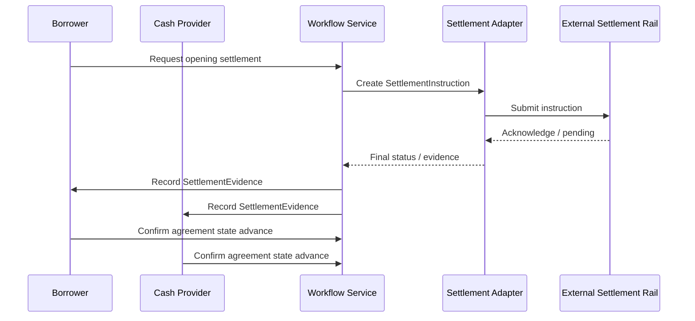
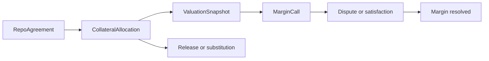
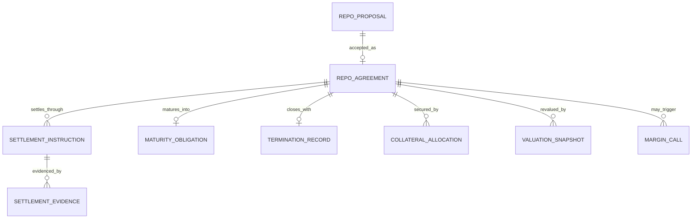
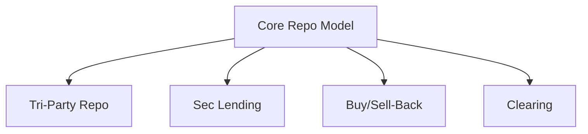
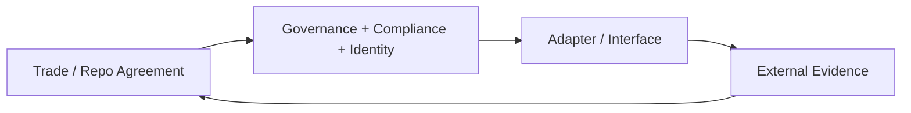

# Workflow diagrams and contract relationships

This document summarizes the primary flow and relationship diagrams for the CROWN DAML model.

## 1. Repo lifecycle overview

The lifecycle is intentionally represented as a sequence of contracts and evidence-based transitions, not as a single mutable record with arbitrary strings.

---

## 2. Settlement evidence workflow

This sequence keeps the instruction and evidence models separate so the bank can distinguish a request from verified completion.

---

## 3. Collateral and margin flow

Business meaning:
- collateral is allocated against the repo agreement
- valuation determines sufficiency or deficiency
- margin call arises when risk coverage is insufficient
- dispute and satisfaction bring the event back to a controlled state

---

## 4. Contract relationship map

This ER diagram shows the intended relationship model and clarifies that the ledger is built from contracts and links rather than a single central table.

---

## 5. Product extension map

The common core can be reused across multiple secured-funding products while preserving distinct legal and operational rules for each extension.

---

## 6. Control-plane relationship

This shows the control plane around the trade: governance and identity feed approval, interface adapters generate operational evidence, and the trade itself only accepts externally validated outcomes.
